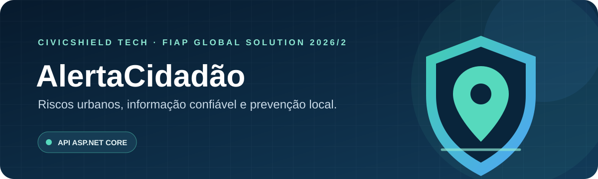
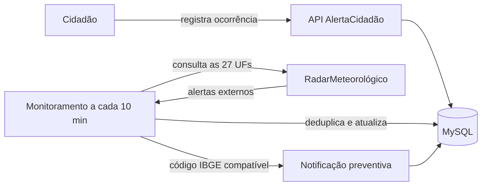

<div align="center">
  

  <br />

  <a href="https://dotnet.microsoft.com/"></a>
  <a href="https://learn.microsoft.com/aspnet/core/"></a>
  <a href="https://www.mysql.com/"></a>
  <a href="https://www.docker.com/"></a>
  <a href="https://xunit.net/"></a>

  <p><strong>API para registrar ocorrências urbanas e acompanhar alertas meteorológicos externos.</strong></p>
</div>

---

## Navegação

[Visão geral](#visão-geral) · [Como funciona](#como-funciona) · [Tecnologias](#tecnologias) · [Executar](#executar-com-docker) · [API](#rotas-da-api) · [Autenticação](#autenticação) · [Monitoramento](#monitoramento-automático) · [Testes](#testes) · [Estrutura](#estrutura-do-projeto)

## Visão geral

O **AlertaCidadão** aproxima informações meteorológicas e relatos de quem vive na cidade. Cidadãos podem registrar situações como alagamentos; a API também consulta alertas publicados pelo RadarMeteorológico e registra notificações preventivas para cidadãos da região compatível.

O sistema mantém esses conceitos separados: **alerta externo é uma informação recebida de um serviço de terceiros; ocorrência é um relato registrado por um cidadão**. Um alerta não confirma que um evento aconteceu em determinado endereço.

### O que a API oferece

- Cadastro e acesso de cidadãos com token JWT.
- Registro e acompanhamento de ocorrências urbanas.
- Consulta de alertas meteorológicos externos e sincronização periódica.
- Notificações preventivas persistidas no MySQL, sem envio por SMS, e-mail, WhatsApp ou push.
- Deduplicação de alertas e idempotência persistente na criação de ocorrências.
- Histórico das execuções do monitoramento.
- Documentação interativa, limitação de chamadas e verificações de saúde.

## Como funciona



## Tecnologias

| Área | Tecnologia |
|---|---|
| API | C# e ASP.NET Core 10 com Minimal APIs |
| Persistência | Entity Framework Core 10 e MySQL 8.4 |
| Provider MySQL | `MySql.EntityFrameworkCore` 10.0.12 |
| Fontes externas | RadarMeteorológico para alertas e catálogo oficial de localidades do IBGE |
| Segurança | JWT Bearer e hashing de senhas do ASP.NET Core Identity |
| Documentação | Swagger e OpenAPI |
| Execução local | Docker e Docker Compose |
| Testes | xUnit |

## Executar com Docker

### Pré-requisitos

- Docker Desktop com Docker Compose.
- Git, se for clonar o repositório.

### Subir a aplicação

Na pasta do repositório, copie o arquivo de exemplo e ajuste as credenciais locais:

```bash
cp .env.example .env
```

No PowerShell, use `Copy-Item .env.example .env`. Edite `.env` e defina senhas locais fortes e uma chave JWT aleatória com pelo menos 32 bytes. O `.env` não deve ser enviado ao repositório.

Inicie os serviços:

```bash
docker compose up --build -d
```

O Compose inicia o MySQL e aguarda a verificação de saúde TCP antes de iniciar a API. O script `docs/schema.sql` é aplicado automaticamente quando o volume do MySQL é inicializado pela primeira vez.

Se o banco já tinha um volume persistente antes da inclusão do catálogo municipal, execute uma vez `docs/migrations/002-catalogo-municipios.sql` no DBeaver. O Compose não reaplica scripts de inicialização em volumes existentes.

| Serviço | Endereço |
|---|---|
| Swagger | [http://localhost:8080/swagger](http://localhost:8080/swagger) |
| API | [http://localhost:8080](http://localhost:8080) |
| Disponibilidade | [http://localhost:8080/health/live](http://localhost:8080/health/live) |
| Prontidão e MySQL | [http://localhost:8080/health/ready](http://localhost:8080/health/ready) |

### Comandos úteis

```bash
docker compose ps
docker compose logs -f api
docker compose logs -f mysql
docker compose down
```

`docker compose down` mantém os dados do volume. Apagar o volume remove os dados locais do banco e não é necessário para reiniciar a aplicação.

### Executar a API fora do Docker

Com o MySQL em execução, configure `ConnectionStrings__Default` e `Jwt__SigningKey` no ambiente e rode:

```bash
dotnet run --project AlertaCidadao
```

O .NET não carrega automaticamente `.env` quando a API é iniciada diretamente pelo Visual Studio ou por `dotnet run`; configure as variáveis no ambiente de execução ou use o Compose.

## Rotas da API

As listas recebem `pagina` e `tamanhoPagina`. O tamanho é limitado a 100 itens.

| Método | Rota | Acesso | Descrição |
|---|---|---|---|
| `POST` | `/api/autenticacao/cadastro` | Público | Cadastra cidadão |
| `POST` | `/api/autenticacao/entrar` | Público | Autentica e retorna JWT |
| `GET` | `/api/localidades/ufs` | Público | Lista as unidades federativas |
| `GET` | `/api/localidades/municipios?uf=SP` | Público | Lista os municípios da UF informada |
| `GET` | `/api/cidadaos/eu` | Cidadão | Consulta o próprio cadastro |
| `GET` | `/api/cidadaos` | Administrador | Lista cidadãos |
| `GET`, `PUT` | `/api/cidadaos/{id}` | Proprietário ou administrador | Consulta e atualiza cadastro conforme autorização |
| `DELETE` | `/api/cidadaos/{id}` | Administrador | Exclui cadastro sem registros associados |
| `GET`, `POST`, `PUT`, `DELETE` | `/api/ocorrencias` | JWT | Cidadão gerencia as próprias ocorrências; administrador pode consultar e gerenciar registros |
| `GET` | `/api/alertas-oficiais` | Público | Lista alertas externos; aceita filtros regionais e de evento |
| `GET` | `/api/alertas-oficiais/{id}` | Público | Consulta alerta externo |
| `POST`, `PUT`, `DELETE` | `/api/alertas-oficiais` | Administrador | Gerencia alertas externos |
| `POST` | `/api/alertas-oficiais/sincronizar` | Administrador | Executa sincronização manual |
| `GET`, `POST`, `PUT` | `/api/notificacoes` | JWT | Cidadão consulta e atualiza suas notificações; administrador pode gerenciar notificações |
| `DELETE` | `/api/notificacoes/{id}` | Administrador | Exclui notificação |
| `GET`, `POST`, `PUT`, `DELETE` | `/api/execucoes-monitoramento` | Administrador | Consulta e gerencia o histórico de execuções |

`*` As permissões variam por operação: cidadãos acessam seus próprios dados; rotas administrativas exigem perfil `Administrador`. O Swagger mostra o cadeado por operação.

### Exemplo: cadastrar cidadão

```http
POST /api/autenticacao/cadastro
Content-Type: application/json

{
  "nome": "Ana Silva",
  "email": "ana@example.com",
  "senha": "senha-segura-123",
  "municipio": "Campinas",
  "uf": "SP",
  "bairro": "Centro",
  "cep": "13010-000"
}
```

### Exemplo: registrar ocorrência

Envie o token JWT e uma chave única no cabeçalho `Chave-Idempotencia`:

```http
POST /api/ocorrencias
Authorization: Bearer <token>
Chave-Idempotencia: relato-rua-123
Content-Type: application/json

{
  "titulo": "Alagamento na via",
  "descricao": "Água acumulada bloqueia uma faixa da rua.",
  "tipo": "Alagamento",
  "severidade": "Alta",
  "municipio": "Campinas",
  "bairro": "Centro",
  "cep": "13010-000",
  "latitude": null,
  "longitude": null
}
```

Repetir a mesma chave com o mesmo conteúdo reproduz a resposta original. Reutilizar a chave com conteúdo diferente retorna conflito. O registro de idempotência é persistido no MySQL.

## Autenticação

1. Cadastre-se em `POST /api/autenticacao/cadastro`.
2. Faça login em `POST /api/autenticacao/entrar` com `email` e `senha`.
3. No Swagger, clique em **Authorize** e cole o valor de `tokenAcesso` retornado pelo login.

O cadastro cria o perfil `Cidadão`. A pessoa informa município e UF; a API busca o código correspondente no [catálogo oficial de localidades do IBGE](https://servicodados.ibge.gov.br/api/docs/localidades) e mantém esse mapeamento no MySQL. A primeira consulta de municípios de cada UF carrega seu catálogo; consultas seguintes usam os dados locais. O código não é exigido na entrada, mas é retornado como `codigoIbgeMunicipio` na resposta do perfil e nas respostas administrativas de cidadãos.

Para promover uma conta a administrador em ambiente local, atualize a coluna interna no MySQL e faça login novamente para obter um token novo:

```sql
UPDATE Citizens
SET Role = 'Admin'
WHERE Email = 'ana@example.com';
```

O hash de senha não é retornado pela API. Não compartilhe tokens nem publique credenciais no repositório.

## Monitoramento automático

A API consulta exclusivamente o endpoint público do [RadarMeteorológico](https://radarmeteorologico.com.br/api-publica):

```text
GET https://radarmeteorologico.com.br/api/v1/alertas?uf={UF}
```

O monitoramento consulta sequencialmente as 27 UFs (uma requisição por estado) a cada 10 minutos por padrão; o intervalo pode ser ajustado por `MONITORING_INTERVAL_MINUTES`. Isso respeita o cache de 10 minutos informado pelo serviço e evita rajadas paralelas. A origem é registrada como **INMET via RadarMeteorológico**: o RadarMeteorológico é um intermediário de terceiros que reproduz alertas originados do INMET; esta aplicação não chama diretamente a API do INMET.

O vínculo preventivo utiliza códigos IBGE recebidos do serviço e presentes no cadastro do cidadão. A API não deduz bairro, endereço ou coordenadas ausentes na fonte. Se uma ou mais UFs falharem, os demais resultados são processados e a execução fica marcada como concluída parcialmente. Notificações ficam salvas no banco; o envio por canais externos não faz parte desta versão.

## Testes

```bash
dotnet test
```

Os testes do provider usam respostas HTTP controladas e não dependem da disponibilidade do RadarMeteorológico.

## Estrutura do projeto

```text
AlertaCidadao/
├── Data/             # DbContext e configuração do EF Core
├── Endpoints/        # Grupos de rotas Minimal API
├── Entities/         # Entidades persistidas
├── Models/           # DTOs de entrada e saída
└── Services/         # Integração, idempotência e monitoramento
AlertaCidadao.Tests/  # Testes xUnit
docs/
├── schema.sql        # DDL MySQL
├── migrations/       # Ajustes para bancos já inicializados
└── PLANO-TECNICO.md  # Plano técnico e critérios FIAP
```

## Créditos e contexto acadêmico

Desenvolvido pela **CivicShield Tech** para a **FIAP Global Solution 2026/2**, na disciplina **Advanced Business Development with .NET**.

Os alertas externos são atribuídos ao [RadarMeteorológico](https://radarmeteorologico.com.br/api-publica), com referência à sua documentação pública.

